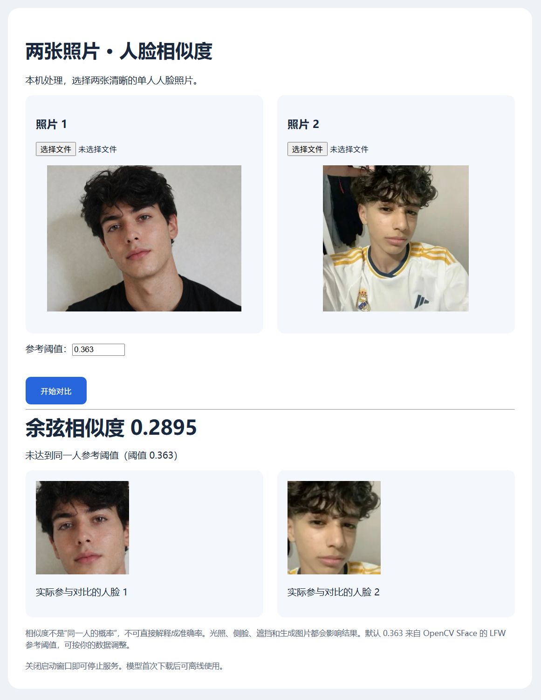
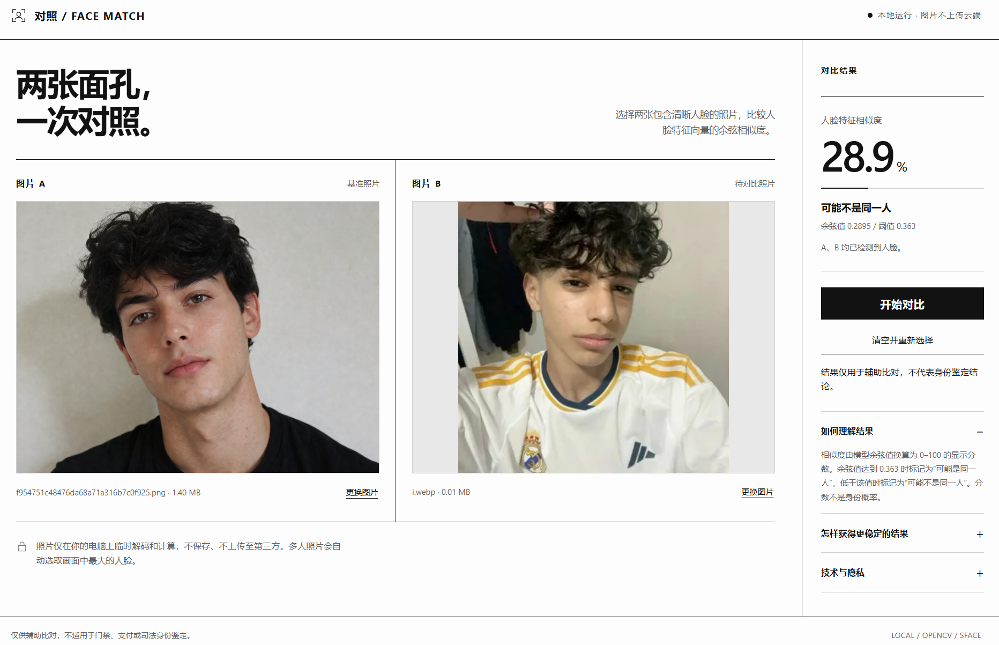

# 人脸相似度对比：GPT 与 Kimi 两版本

两套独立实现，作者归属由用户确认。两者使用 OpenCV YuNet 检测与 SFace 特征匹配，不是两种不同的人脸识别模型。

| 目录 | 来源 | Windows 入口 |
| --- | --- | --- |
| [gpt-6.1-sol](gpt-6.1-sol/) | 仓库原有版本 | `gpt-6.1-sol/start.bat` |
| [kimi-3.1-pro](kimi-3.1-pro/) | 用户本次附件 | `kimi-3.1-pro/start.bat` |

## 界面效果截图

截图由用户上传，按文件名对应版本。两张截图均已显示对比结果：GPT 展示余弦值 `0.2895`，Kimi 展示 `28.9%`，其下原始余弦值同为 `0.2895`；这是同一样例的显示结果，不代表准确率测评。

### GPT-6.1-sol

浅蓝圆角卡片，结果位于照片下方；可调整阈值，并展示实际参与匹配的对齐人脸。

### Kimi-3.1-pro

黑白分栏布局，左侧显示两张大图，右侧集中展示分数、判断与操作按钮。

以上截图补充了实际运行效果证据，说明两版至少在该样例中已完成对比。此前“尚未确认完整启动”的记录描述的是截图提供前的状态；仍未进行统一准确率、速度和多场景稳定性测试。

# GPT-6.1-sol 与 Kimi-3.1-pro：代码与 UI 审查

审查日期：2026-10-24。归属由用户确认：原仓库为 GPT，附件为 Kimi。以下代码与 UI 审查记录以最初整理版本为基准；后续启动与下载修复见文末“更新过程”，当前状态以该节为准。

## 结论

Kimi 更接近完成的网页产品：视觉层级、拖放、状态提示、前后端拆分更完善。GPT 更适合人工核验：展示实际对齐人脸、拒绝多人混比、可调整阈值、自动空闲端口。两套各有明确优势，不能从代码量或界面推断模型识别准确率。

两套都采用 YuNet + SFace、余弦匹配和默认阈值 0.363，但检测阈值分别为 0.8 / 0.7，GPT 还将输入缩小到 1600 以内；即使底层模型相同，检测和匹配结果也可能不同。未用统一标注样本实测准确率或速度。

## 对比

| 项目 | GPT-6.1-sol | Kimi-3.1-pro | 判断 |
| --- | --- | --- | --- |
| 代码结构 | HTML/CSS/JS 内嵌 Python 长字符串 | FaceEngine 类、JSON API、独立 HTML | Kimi 更易扩展和维护 UI |
| 视觉 | 浅蓝背景、圆角白卡片、原生文件选择器 | 黑白极简、双图工作区、独立结果侧栏、移动端断点 | 按源码设计评估，Kimi 更完整；未进行浏览器视觉实测 |
| 上传交互 | 文件选择、本地预览、表单整页提交 | 拖放、文件名和大小、替换、重置、异步请求 | Kimi 操作更顺畅 |
| 结果可解释性 | 原始余弦值、可调阈值、实际对齐脸预览 | 大号百分数、进度条、余弦和固定阈值 | GPT 核验信息更关键 |
| 多人照片 | 拒绝并要求裁剪 | 选最大脸，文字提示检测数量 | GPT 更能避免比错人；Kimi 应增加脸框/选脸 |
| 输入处理 | Pillow EXIF 转正，缩小到 1600 | OpenCV 解码，限制 6 MB 和 3000 万像素 | GPT 控制推理尺寸；Kimi 错误检查更细 |
| 错误响应 | 广泛捕获异常，错误页通常仍返回 200 | 400/413/503/500 分类，前端显示错误 | Kimi 更利于 API 集成 |
| 并发 | 全局锁保护检测和匹配 | 加载锁、推理锁分离 | 两者都有推理串行保护 |
| 模型下载 | 单源、临时文件、最小尺寸校验 | 三源回退、临时文件、SHA-256 校验 | Kimi 完整性设计更强；下载地址和哈希未联网验证 |
| 服务启动 | Waitress，本机地址，端口 0 自动分配 | Flask 内置服务，默认固定 5000，可环境变量修改 | GPT 日常启动更稳妥 |
| 安装 | 安装标记跳过重复安装 | 每次执行 pip；BAT 自解压 | GPT 启动开销更低，Kimi 单文件分发方便 |

## 已发现的问题

### GPT

1. `app.py` 中 PAGE 是一个长字符串，视觉维护和差异审查困难。
2. 表单整页刷新后，预览仍显示，但浏览器文件输入已清空；再次提交需要重新选择图片，容易误导用户。
3. 检测器、识别器仅在 `__main__` 初始化。通过 WSGI 导入并直接请求识别接口会缺失全局对象；错误又被广泛捕获，可能以 HTTP 200 返回错误页面。
4. 模型仅按大小检查，没有摘要校验和备用源。`installed-v1.ok` 也不会随依赖文件内容变化自动失效。
5. 原始 README 写固定 7860 和端口冲突处理，与现有自动端口实现不一致。
6. 原始 BAT 同样未处理失效代理；本次保留原实现用于比较。

### Kimi

1. `similarity = clip(cosine, 0, 1) * 100` 只是缩放分数，且负值被截断；大号百分比可能让用户误以为是同一人概率。默认判定阈值实际上对应显示分数 36.3%，应优先展示原始余弦和清楚的分数定义。
2. 多人照片自动选最大脸，没有展示选中的脸框或裁剪图，可能比较到错误对象。
3. 允许 3000 万像素原尺寸进入检测，没有推理前缩放；高分辨率图片可能显著增加 CPU 时间和内存。像素限制发生在解码后，也不能避免解码阶段的大图内存开销。
4. 固定端口 5000 可能冲突；Flask 内置服务不如 GPT 的 Waitress 启动方案完整。
5. 对比过程中仍可点击选择/替换图片，`selectFile` 没检查 busy；旧请求结果可能显示在新图片旁。拖放有 busy 检查，但文件选择没有。
6. 推理请求没有前端超时/取消控制。首次启动在服务打开前加载模型，前端却提示“首次对比可能需要下载模型”，文案与正常启动流程不一致。
7. 自解压 BAT 每次覆盖源码，修改 app.py 后再双击会丢失修改。原始版还受失效代理影响；修复版仅处理依赖安装阶段，模型下载仍依赖当前网络/代理。
8. 健康接口把 detector 是否存在作为加载状态，但 load 先赋 detector 再赋 recognizer，存在极短的状态不完整窗口；不影响当前串行 compare 的正常路径。

## 推荐取舍

若继续完善：以 Kimi 的分离结构和界面为基础，引入 GPT 的对齐人脸展示、可调阈值、自动端口和 Waitress；补上选图期间并发保护和输入缩放。分数保留原始余弦，百分比仅作为明确说明的可视化。此次没有将这些建议改入原程序，确保比较对象可追溯。

## 验证范围

完成两套 Python 语法检查、Kimi 前端 JS 语法检查、两个自解压 BAT 内嵌 ZIP 完整性和源码一致性检查。未执行 Windows BAT，未下载 ONNX 模型，未做真实人脸识别、性能或浏览器渲染测试。UI 判断来自 HTML/CSS/JS 静态审查，不冒充运行实测。

## 更新过程（2026-10-24）

以下按实际反馈与修复顺序记录。两版均发生过启动失败，不能把源码审查或局部修复当作“一键启动已验证”。

| 顺序 | 用户反馈 / 发现 | 原因与处理 | 更新文件 / 提交 |
| --- | --- | --- | --- |
| 1 | Kimi 安装 Flask 时出现 ProxyError、WinError 10061，末尾提示找不到 Flask 版本 | pip 连接失效代理，末尾的版本提示是网络失败的后果。先在安装阶段临时清理代理配置、设置 NO_PROXY，并在清华源失败后尝试官方 PyPI；此时尚未覆盖模型下载阶段。 | Kimi 启动脚本；早期代理修复随 [两版整理](https://github.com/feeday/face-bat/commit/d65345c) 一起入库，原始脚本另存为 start-original.bat |
| 2 | Kimi 下载 OpenCV 源码包，进入长时间编译，最后链接 python3.lib 失败 | 启动脚本选中了 Python 3.14 自由线程版（cp314t），没有匹配的 OpenCV wheel。改为只接受普通 CPython 3.11/3.12 64 位，并使用 --only-binary=:all: 禁止源码编译；使用独立 .venv-kimi，旧 .venv 保留。 | [Kimi start.bat](kimi-3.1-pro/start.bat) · [fbc33ce](https://github.com/feeday/face-bat/commit/fbc33ce) |
| 3 | GPT 安装 Flask 也出现 ProxyError、WinError 10061 | GPT 同样缺少失效代理处理。为 pip 增加临时代理绕过、清华源到官方源回退及仅安装 wheel 的限制。此轮同样只覆盖依赖安装。 | [GPT start.bat](gpt-6.1-sol/start.bat) · [9993fb6](https://github.com/feeday/face-bat/commit/9993fb6) |
| 4 | Kimi 已用 Python 3.12.10 成功安装依赖，但三个模型源仍连接 127.0.0.1:7890 失败；BAT 中文提示被当成命令 | 安装结束后代理绕过作用域已退出。将绕过保留到本次启动进程结束，覆盖模型下载；BAT 命令和提示改为 ASCII 英文，规避观察到的编码问题。系统代理设置不变，内嵌程序载荷不变。 | [Kimi start.bat](kimi-3.1-pro/start.bat) · [3def890](https://github.com/feeday/face-bat/commit/3def890) |
| 5 | GPT 模型下载也报 URLError / WinError 10061 | 该堆栈仅能确认连接被拒绝，不能单独确定是代理还是目标地址不可达。下载器改为先用空 ProxyHandler 显式直连，依次尝试 GitHub、HF 镜像、Hugging Face；全部直连失败后再按系统网络配置重试。单次连接/读取超时设为 25 秒；保留缓存、临时文件清理与最小尺寸检查。 | [GPT app.py](gpt-6.1-sol/app.py) · [61d76d1](https://github.com/feeday/face-bat/commit/61d76d1) |

### 当前使用方式

- **GPT**：更新同目录的 `start.bat` 和 `app.py`，双击 `start.bat`。已有 `.venv` 和有效模型缓存继续复用，无需为本次修复删除环境。模型在 `models/`。
- **Kimi**：安装普通版 Python 3.11 或 3.12 64 位，更新 `start.bat` 后双击。修复版 BAT 自带程序载荷，使用 `.venv-kimi`，模型在 `.models/`；原 `.venv` 保留。
- Kimi 的 `start-original.bat` 仅用于保留原始实现，不包含这些启动修复。其自解压脚本会覆盖同目录 `app.py`、`index.html`、`requirements.txt`，自行改源码时须注意。
- 网络必须能访问至少一个模型下载源。修复代理处理不等于保证所有网络环境都能下载成功。

### 验证结果与剩余限制

- **用户日志已确认**：Kimi 正确选择 Python 3.12.10，并成功安装 Flask、NumPy、OpenCV、Pillow、requests 等依赖；随后在模型下载阶段失败。这证明依赖阶段修复有效，不代表整套程序已启动成功。
- **本地检查已完成**：Python/前端 JavaScript 语法；Kimi BAT 内嵌 ZIP 完整性及源码一致性；ASCII 启动命令与代理设置作用域检查。
- **GPT 下载器已做模拟测试**：首个源连接被拒绝后切换备用源、复用已有模型、清理临时文件。模拟测试没有下载真实 ONNX 模型。
- **尚未确认**：最后一轮修复后两版在用户 Windows 上完整启动、真实模型下载与识别结果。未做两版准确率、速度或浏览器渲染的统一实测。
- 此次修复集中于环境、代理和下载流程，没有合并两版 UI 或修改人脸匹配算法。GPT 模型仍按最小尺寸检查，未增加 SHA-256 校验；Kimi 原有 UI 并发和百分比分数表达等问题仍属于后续改进项。

### 对先前结论的修正

先前根据 Python 版本限制与自动端口设计判断“GPT 一键启动更可靠”，表述过早。实际反馈表明两版都未完整处理失效代理和模型下载。较准确的结论是：GPT 初始版在 Python 版本选择上更谨慎，Kimi 初始版界面交互更完整；两者的完整交付可靠性都必须通过真实启动验证。
